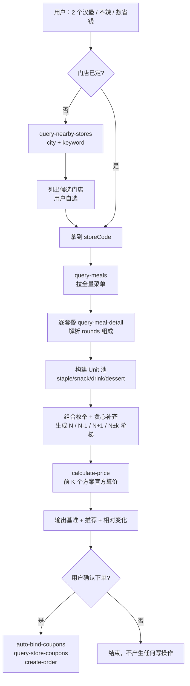

# 麦当劳 MCP 集成说明

本文说明 `mcd-order-helper` 实际调用了哪些麦当劳 MCP Server / Tool、调用顺序如何编排，以及这套编排带来的业务价值。

## 1. 使用的 MCP Server

| 项目 | 值 |
|---|---|
| Server 名称 | `mcd-mcp`（麦当劳中国官方 MCP Server） |
| 传输协议 | Streamable HTTP（JSON-RPC 2.0 over HTTPS） |
| 端点 | `${MCD_MCP_URL}`，官方为 `https://mcp.mcd.cn` |
| 鉴权 | 请求头 `Authorization: Bearer ${MCD_MCP_TOKEN}` |
| Token 获取 | 登录 `open.mcd.cn` 在控制台激活 MCP 服务后申请 |
| 凭证存放 | 运行时从本机 `~/.workbuddy/mcp.json` 读取，或用环境变量覆盖；**仓库内不含任何真实 Token** |
| 接入方式 | WorkBuddy「专家·技能·连接器 → 连接器 → 自定义连接器 → 配置 MCP」贴入脱敏配置 |

脱敏示例见仓库根目录 [`mcp-config.example.json`](mcp-config.example.json)，只使用 `${MCD_MCP_URL}` / `${MCD_MCP_TOKEN}` 占位符。

## 2. 脚本直接调用的 Tool

项目的核心计算（菜单解析、组合优化、算价复核）全部由 `scripts/` 下的 Python 通过 JSON-RPC 直接调用以下 4 个 Tool，不依赖模型临场发挥，因此结果可复现、可断言。

| # | Tool | 关键入参 | 出参要点 | 在本项目中的作用 | 代码位置 |
|---|---|---|---|---|---|
| 1 | `query-nearby-stores` | `beType`、`searchType=2`、`city`、`keyword` | `data[]`：`storeCode`、`storeName`、`address`、`distance`、`businessStatus`、`beCode` | 按「城市 + 商圈」列出门店候选，交给用户自己选；**不使用收藏门店** | `order_helper.search_stores()` |
| 2 | `query-meals` | `storeCode`、`orderType`、`beType`、`beCode` | `data.meals{code}`：`name`、`currentPrice`、`originalPrice`、`discountType` | 拉取门店全量菜单，作为候选商品池 | `menu_model.build_units()` |
| 3 | `query-meal-detail` | `storeCode`、`code`、`orderType`、`beType` | `data.rounds[]`：每个选配轮次的 `name`、`quantity`、`choices[]`（含 `isDefault`） | 解析套餐真实构成（1 主食 + n 小食 + 1 饮料），**不靠名字猜「N 件套」** | `menu_model.build_units()` |
| 4 | `calculate-price` | `storeCode`、`orderType`、`beType`、`items[{productCode, quantity}]` | `data.price`（**单位：分**）、`data.originalPrice` | 对最终方案做官方算价复核，防止菜单价失真导致报错价 | `order_helper.main()` 的 `--verify` |

## 3. 下单环节的 Tool（由技能指导 Agent 调用）

脚本只做「推荐 + 报价」，**不做任何写操作**。用户明确要下单时，由 `SKILL.md` 指导 Agent 调用：

| Tool | 用途 |
|---|---|
| `auto-bind-coupons` | 自动领取可用优惠券 |
| `query-store-coupons` | 查询该门店可叠加的券 |
| `create-order` | 按用户确认的购物篮建单（需用户二次确认） |

## 4. 调用流程

各 Tool 之间的依赖是**严格串行**的：门店是菜单的前置，菜单是套餐详情的前置，套餐详情是组合优化的前置，组合结果是算价的前置。任何一层失败都不会用「模型记忆里的麦当劳信息」兜底，而是直接报错说明。

## 5. 关键工程细节（踩坑记录）

| 坑 | 说明 | 处理方式 |
|---|---|---|
| **金额单位不统一** | `query-meals` 的 `currentPrice` 是**元**（字符串 `"33.5"`），`calculate-price` 的 `price` 是**分**（整数 `3350`）。混算会错 100 倍 | 只在解析菜单时用元，算价结果统一 `/100` 后再比较 |
| **菜单价可能是「有卡价」** | `discountType` 含「随单购」的餐品，`currentPrice` 是需要麦金卡才成立的低价。实测板烧鸡腿堡四件套菜单标 28 元，`calculate-price` 实算 57 元 | 默认按 `originalPrice` 计价；用户声明有卡才用卡价，且输出标注「需麦金卡，卡价需结算时把麦金卡一并加入购物车」 |
| **「N 件套」不能按名字推断** | 名字里的件数只适用于标准套餐，儿童餐、随心配、四宫格都不符合 | 一律以 `query-meal-detail` 的 `rounds` 默认选项判定角色 |
| **`orderType` 依赖 `beType`** | 到店自取、外送、得来速的取值不同，传错查不到菜单 | 统一由 `beType ∈ {1,5}` → `orderType=1`、`beType ∈ {2,6}` → `orderType=2` 自动决定；外送同时传 `beCode` |
| **门店搜索必须带关键词** | `searchType=2` 只给 `city` 不给 `keyword` 会返回 0 家 | 强制「城市 + 商圈/路名/店名」，缺一即报错并给出示例命令 |
| **门店可能不营业** | 返回 `code 600057`（已关闭或不在营业时间） | 候选列表按「营业中优先」排序并加 `*` 标记，由用户决定换店 |
| **批量拉详情会超时** | 单次详情约 0.3 秒，但默认 40 秒超时 × 3 次重试遇上慢请求会卡到 120 秒 | 批量拉取改用 6 并发 + 15 秒超时 + 不重试，冷启动稳定在 7 秒内 |

## 6. 业务价值

### 对消费者：把「套餐经济学」算清楚

- 麦当劳的套餐组合空间极大（单品 × 套餐 × 随心配 × 加价购），人脑几乎无法穷举。本项目把「几个主食、几杯饮料、几种品类、多少钱」变成可计算的约束，输出**当前门店、当前时点的真实最优解**，而不是通用建议。
- 所有报价都过一遍 `calculate-price`，规避「菜单价 28、实付 57」这类价格幻觉。
- 强制展示 **主食数 N±1 的对照方案**，让用户看见「少一个主食省多少、多一个主食多拿多少」，而不是只给一个黑盒答案。

### 对麦当劳：把「比价流失」转成「组合升级」

- 决策发生在下单前。给出 N+1 方案并写清「多 ¥14 多 1 个主食 + 1 件食物」的边际收益，是把客单价往上带的最自然方式，且用户感知是「我赚了」而不是「被推销」。
- 充分使用菜单里长尾的套餐 SKU（随心配、四宫格、学生专享），这些是转化率洼地，人工点单时几乎不会被主动发现。
- 全程不下单、不写数据，属于纯导购型流量入口，零运营风险。

### 对平台：MCP 能力的可复用范式

- 演示了「把模型从计算环节移除」的做法：模型只负责理解自然语言和转述结论，枚举与算价交给代码。这解决了 LLM 做加减乘除不可靠的固有问题，也让结果可被自动化测试断言（本项目自测覆盖 441 项断言）。
- `query-meal-detail` 的 `rounds` 解析、分/元换算、`beType`/`orderType` 映射等经验，对其他基于麦当劳 MCP 的项目可直接复用。

## 7. 安全与合规边界

- **不写死凭证**：Token 只从本机配置或环境变量读取；仓库内 `mcp-config.example.json` 全为占位符，已全仓扫描确认无真实 Token。
- **不做静默写操作**：脚本无任何下单能力；`create-order` 仅在用户明确确认后由 Agent 调用。
- **不编造数据**：任一 Tool 调用失败即报错退出（退出码 2/3/4/5），不用训练记忆顶替真实菜单。
- **不采集个人信息**：仅使用门店编码与商品编码，不涉及手机号、地址、账号。
- 非麦当劳官方产品，商标与餐品信息归权利人所有，价格以官方结算页为准。
